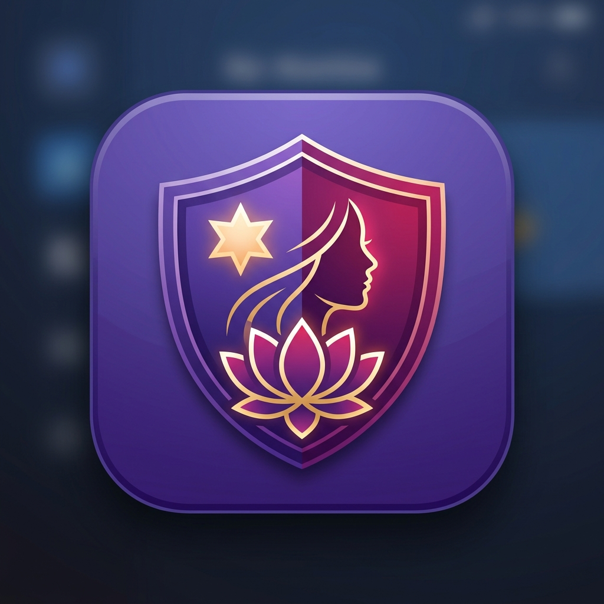

<p align="center">
  
</p>

# 🛡️ Suraksha Ghaziabad (सुरक्षा ग़ाज़ियाबाद)
> *"Aapki Suraksha, Hamari Zimmedari"*  
> **Ghaziabad Seva First Innovation Challenge 2026** • Problem Statement: **Safe City for Women**

[-black?style=for-the-badge&logo=android)](https://github.com/adisharma9548/suraksha-ghaziabad/raw/main/releases/SurakshaGhaziabad-v1.0.1.apk)
[](test/)
[](lib/main.dart)
[](lib/core/services/sms_service.dart)
[](web_admin/)

---

## 📲 Direct APK Download (Android)

Anyone can immediately download and install the latest compiled production-style APK directly on any Android device:

| Version | File Name | Direct Download Link | Size | Minimum OS |
| :---: | :--- | :--- | :---: | :---: |
| **v1.0.1 (Latest)** | **SurakshaGhaziabad-v1.0.1.apk** | [📥 **Download SurakshaGhaziabad-v1.0.1.apk**](https://github.com/adisharma9548/suraksha-ghaziabad/raw/main/releases/SurakshaGhaziabad-v1.0.1.apk) | **56.9 MB** | Android 7.0+ (API 24+) |
| v1.0.0 | SurakshaGhaziabad-v1.0.apk | [📥 Download SurakshaGhaziabad-v1.0.apk](https://github.com/adisharma9548/suraksha-ghaziabad/raw/main/releases/SurakshaGhaziabad-v1.0.apk) | 57.3 MB | Android 7.0+ (API 24+) |

> **Latest Repository File Path**: [`releases/SurakshaGhaziabad-v1.0.1.apk`](releases/SurakshaGhaziabad-v1.0.1.apk)  
> **SHA-256 Checksum (v1.0.1)**: `9DE21B48C3890A52DFD123DBC2CEF80FC04D93B1BE21144A20126439E16C1433`

### 🆕 What's New in v1.0.1
- **Native iOS Human Interface Guidelines (HIG) Redesign**: Redesigned all 22 screens with SF Pro typographic scale, native grouped inset lists, Cupertino segmented controls, collapsible navigation headers, and frosted-glass blurred chrome.
- **Greyscale-First, Color-Blind Safe Architecture**: Meets strict **WCAG AAA** contrast standards (≥7:1 body, ≥12:1 headings) with dark and light palettes.
- **Multi-Cue State Indicators**: Completely eliminated reliance on color alone. Statuses, warnings, and states are conveyed using icon + bold label + border weight + hatched/patterned visual fills (stripes, dots, crosshatch).
- **Accessibility Enhancements**: Support for Dynamic Type (scales up to 200%), Reduce Motion, Reduce Transparency, VoiceOver semantic labels, and minimum 44×44pt touch targets.

### 📋 Installation Steps on Android:
1. Tap the download link above on your Android phone (or download via Chrome / Files).
2. When prompted by Android that the file was downloaded from an external browser, tap **Settings** ➔ toggle **Allow from this source** (or tap **Install Anyway**).
3. Tap **Install** and open **Suraksha Ghaziabad**.
4. Grant runtime permissions for Location (used only during active SOS/Trip), Notifications, and Microphone.

---

## 📱 Executive Overview
**Suraksha Ghaziabad** is a production-style, secure mobile application and integrated district command ecosystem architected specifically for women's safety across Ghaziabad, Uttar Pradesh.

Unlike speculative apps that claim direct automated emergency dispatch without government clearance, **Suraksha Ghaziabad is designed to actively COMPLEMENT the national Dial 112 / ERSS (Emergency Response Support System)**:
1. **Immediate 112 Voice Link**: Upon triggering an SOS, the app automatically opens an active call to `tel:112` via the Android telecom dialer so the citizen speaks directly with an official police emergency dispatcher.
2. **Real-time Live Telemetry & Control Room**: Concurrently writes the incident to Cloud Firestore, initiates a foreground service streaming live GPS breadcrumbs every 5 seconds, notifies trusted emergency circles via SMS intents, and broadcasts high-priority push notifications to district police patrol units.
3. **Decoy Duress PIN Protection**: If coerced by an attacker to cancel an alarm, the victim enters a secondary Decoy Duress PIN. The phone screen visibly clears to protect the victim from immediate harm, while silently continuing live GPS streaming to police control room consoles with critical flashing stealth intervention alerts.
4. **Civic vs Policing Dynamic Routing**: Public safety reports are automatically segregated by hazard type—routing streetlights, dark spots, and broken roads to **Nagar Nigam Ghaziabad**, and stalking or harassment threats to **UP Police**.

---

## 🎨 Official Brand Logo & Visual Identity

The official **Suraksha Ghaziabad** logo incorporates:
- **Protective Armor Shield**: Represents municipal vigilance, emergency shelter, and district police protection.
- **Empowered Woman Silhouette**: Embodies resilience, dignity, and personal autonomy.
- **Blooming Lotus of Hope**: Honors Uttar Pradesh's cultural heritage and peaceful civic life.
- **Guiding Radiant Star**: Reflects the 24/7 watchful vigilance of the control room.
- **Color Palette**: Royal Purple (`#6750A4`), Deep Magenta (`#B3261E`), and Luminous Warm Gold accents matching the Material 3 design system.

Assets are located in:
- High-res vector render: [`docs/assets/logo.png`](docs/assets/logo.png)
- Flutter App asset: [`assets/images/app_logo.png`](assets/images/app_logo.png)
- Control room web icon: [`web_admin/public/logo.png`](web_admin/public/logo.png)

---

## 🏛️ System Architecture

```
┌─────────────────────────────────────────────────────────────────────────────┐
│                            SURAKSHA GHAZIABAD                               │
└─────────────────────────────────────────────────────────────────────────────┘
                                       │
            ┌──────────────────────────┴──────────────────────────┐
            ▼                                                     ▼
┌──────────────────────────┐                               ┌──────────────────────────┐
│   MOBILE APP (Flutter)   │                               │    WEB ADMIN (Next.js)   │
│  - Citizen SOS & Trips   │                               │  - Live SOS Situation Map│
│  - Background GPS Stream │                               │  - Audio Siren Alarms    │
│  - Decoy Duress PIN      │                               │  - Patrol Unit Dispatch  │
│  - Heatmap & Reports     │                               │  - Nagar Nigam Queue     │
│  - Tel:112 Complement    │                               │  - Analytics CSV Export  │
└──────────────────────────┘                               │  - Audit Log Viewer      │
            │                                              └──────────────────────────┘
            │                                                             │
            └──────────────────────────┬──────────────────────────────────┘
                                       ▼
┌─────────────────────────────────────────────────────────────────────────────┐
│                            FIREBASE BACKEND                                 │
├─────────────────────────────────────────────────────────────────────────────┤
│ • Firebase Auth: Phone OTP (SMS Horizon DLT Gateway) & Email 2FA            │
│ • Cloud Firestore: Strict Rules, Coordinates Bounding, Status Immutability  │
│ • Cloud Functions: FCM Broadcasts, Rate Limiting, Server-Side Audit Logs    │
│ • App Check: Play Integrity (Android) & DeviceCheck (iOS)                   │
│ • Cloud Storage: Encrypted SOS Audio Evidence & Hazard Spot Photos          │
└─────────────────────────────────────────────────────────────────────────────┘
```

---

## 🔐 Security & Production Rules

### 1. Cryptographic Security & Custom Claims
- **Strict Role Verification**: Officer and admin roles are verified **exclusively via Firebase Auth Custom Claims** (`request.auth.token.role == 'officer'`). Checking Firestore document fields is strictly prohibited.
- **Coordinate Bounding**: All location writes are verified against Ghaziabad geographic bounds (`28.30°N` to `29.15°N`, `77.10°E` to `77.85°E`).
- **Citizen Status Immutability**: Citizens can only initiate an SOS with status `triggered` or cancel it. Citizens cannot forge patrol assignments (`assigned`) or resolutions (`resolved`).
- **Cryptographic PIN Hashing**: Both emergency cancellation PINs and decoy duress PINs are hashed using cryptographic **SHA-256** with local salt (`HashUtil.hashPin()`). Plaintext PINs are never stored or transmitted.

### 2. Immutable Server-Side Audit Trail
Every critical lifecycle event is logged immutably to the `audit_logs` collection exclusively via Firebase Admin SDK in Cloud Functions:
- `SOS_TRIGGERED`: Distress initiation with GPS coordinates
- `SOS_DURESS_TRIGGERED`: Silent coercion alert detection
- `SOS_PATROL_ASSIGNED`: Unit dispatch with officer ID
- `SOS_RESOLVED`: Incident resolution timestamp
- `REPORT_ROUTED`: Hazard classification and authority queue routing

---

## 📲 Real SMS Horizon Gateway API

Suraksha Ghaziabad integrates directly with the **SMS Horizon Gateway** for high-deliverability TRAI/DLT-compliant SMS OTP verification:

- **Endpoint**: `https://smshorizon.com/api/v2/sendsms`
- **Method**: HTTP POST with Bearer Token Authorization
- **Sender ID**: `HORIZN` (Registered DLT header)
- **DLT Template ID**: `1607100000000323238`
- **Exact Message Template**:
  ```text
  OTP for your new user account registration is: {#var#}

  - SmsHorizon
  ```
- **SMS Fallback via URL Intent**: The dangerous `android.permission.SEND_SMS` permission has been completely eliminated for Google Play compliance. Offline emergency fallback launches Android SMS intents (`sms:phone?body=...`) directly through the user's default SMS app.

---

## 💻 Web Admin Panel (Next.js 14)

Located in `web_admin/`, the administrative console is an isolated Next.js + React web application designed for police and municipal control rooms:

1. **Authentication**: Email/password with 2FA verification and server-side claims check.
2. **Live SOS Board**: Real-time Firestore stream with OpenStreetMap Leaflet visualization and moving breadcrumb trail.
3. **Web Audio Siren**: Native `AudioContext` alarm synthesizer sounding audible sirens on new distress signals and distinctive pulsed sirens on silent duress alerts.
4. **Reports Moderation Queue**: Separate filtering tabs for **Nagar Nigam Ghaziabad** (civic hazards, streetlights, potholes) and **UP Police** (stalking, harassment). Updates citizen acknowledgement status in real time.
5. **Verified Directory Manager**: CRUD manager for police stations, Pink Booths, women help desks, and trauma centers with mandatory `source` and `verifiedAt` audit fields.
6. **Officer Role Management**: Invokes the `setOfficerRole` Cloud Function to securely mint officer/admin custom claims.
7. **Ward Analytics & CSV Export**: Real response times computed from `assignedAt - startedAt` differences, 7-day time-decay formula across Ghaziabad's 5 administrative zones (Vasundhara, Mohan Nagar, Kavi Nagar, Vijay Nagar, City Kotwali), and one-click CSV export.
8. **Audit Log Viewer**: Read-only forensic view of the server-side audit trail.

---

## 🧪 Automated Test Suite

The project includes 18 comprehensive unit and state machine tests:

```bash
flutter test
```

### Test Coverage Highlights:
- `test/firebase_auth_repository_test.dart`:
  - Validates PIN verification against SHA-256 hash.
  - Verifies unauthorized attempts return false.
  - Verifies Decoy Duress PIN validation against `duressPinHash`.
  - Verifies profile updates and trusted contact circles.
- `test/firebase_repositories_test.dart`:
  - Complete SOS state machine: `triggered` ➔ `assigned` ➔ `resolved`.
  - Silent decoy duress mode: `triggered` ➔ `duress_active`.
  - Breadcrumb streaming during active emergencies.
  - Report submission and Nagar Nigam / Police status updates.
  - Trip Safe lifecycle (start, safety check, completion).
  - Nearest patrol unit selection using Haversine distance.
- `test/widget_test.dart`:
  - Distance utility calculations.
  - Ward mapping and category routing logic.

---

## 📋 Remaining Manual Deployment Steps

To transition this project into full live field operations in Ghaziabad, the following manual administrative steps are required:

### 1. Firebase Console Configuration
1. **Deploy Rules and Functions**:
   ```bash
   firebase deploy --only firestore:rules,storage:rules
   cd functions && npm install && cd ..
   firebase deploy --only functions
   ```
2. **Enable Phone & Email Auth Providers**:
   - Go to **Firebase Console ➔ Authentication ➔ Sign-in method**.
   - Enable **Phone** and **Email/Password**.
3. **Enable Firebase App Check**:
   - Go to **Firebase Console ➔ App Check**.
   - Register your Android app with **Play Integrity** (add SHA-256 fingerprint from Google Play Console).
   - In development, generate a debug token in Logcat and register it in the App Check console.

### 2. Officer & Police Station Onboarding
1. Create police supervisor accounts in Firebase Auth.
2. Grant officer custom claims using the Cloud Function:
   ```javascript
   // Call from an admin account:
   const setRole = firebase.functions().httpsCallable('setOfficerRole');
   await setRole({ targetUid: 'OFFICER_FIREBASE_UID', role: 'officer' });
   ```
3. Import the official verified Ghaziabad emergency directory:
   ```bash
   dart run scripts/import_help_places.dart /path/to/official_ghaziabad_stations.csv
   ```

### 3. Official UP Police & ERSS 112 Administrative Agreement
- **Status Notice**: The mobile app currently initiates direct telephone calls to `tel:112` and pushes incidents to its own integrated control room feed.
- **Direct ERSS API Machine Integration**: Direct programmatic injection into UP Police ERSS CAD (Computer Aided Dispatch) servers requires an official Memorandum of Understanding (MOU) with the Uttar Pradesh Police Technical Services Headquarters (Lucknow) and CDAC.
- **Do Not Claim Direct Machine Dispatch**: Until this formal MOU is finalized, the app transparently communicates this distinction to users as per `AppConstants.policeIntegrationNotice`.

---

## 🏃 Running the Applications

### Mobile Application (Android)
```bash
# Verify environment
flutter doctor

# Run on connected Android device
flutter run
```

### Web Admin Panel (Next.js)
```bash
cd web_admin

# Install dependencies (if not already installed)
npm install

# Start local control room server
npm run dev
# Accessible at http://localhost:3000
```

---

## 📄 License & Attribution
Developed for the **Ghaziabad Seva First Innovation Challenge 2026**.  
*Emergency helpline references: Dial 112 (National Emergency), 1090 (Women Power Line), 181 (Women Helpline).*
