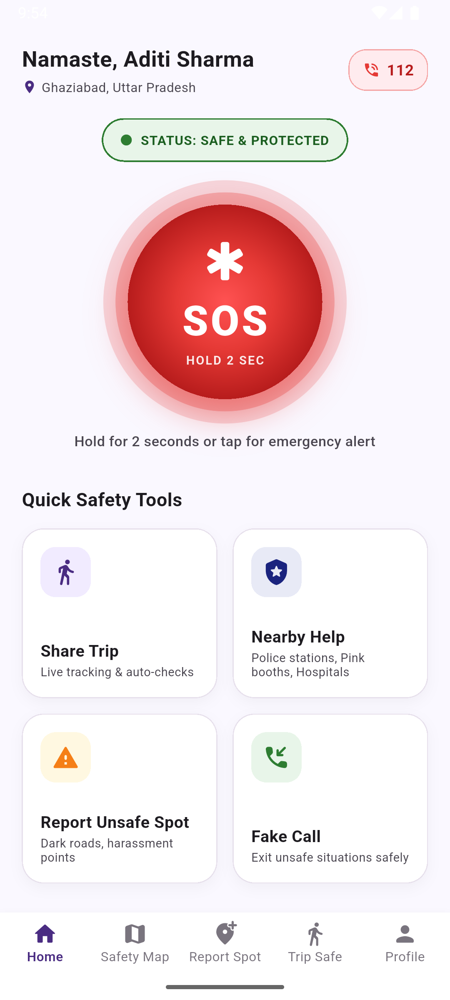
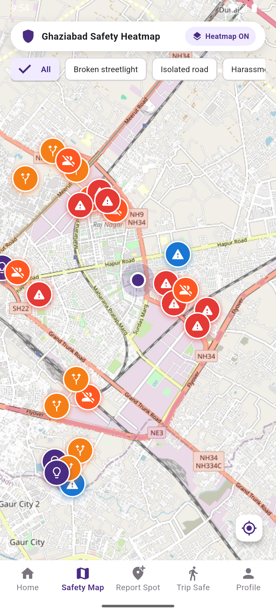
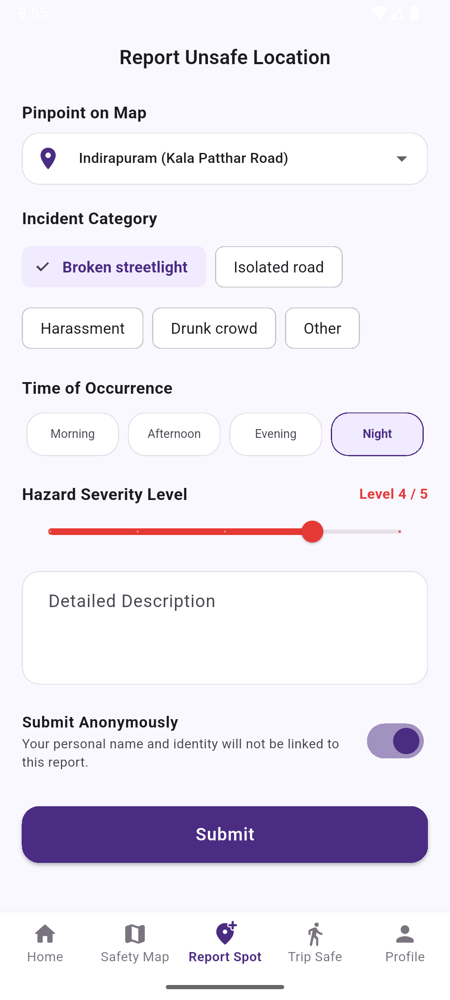
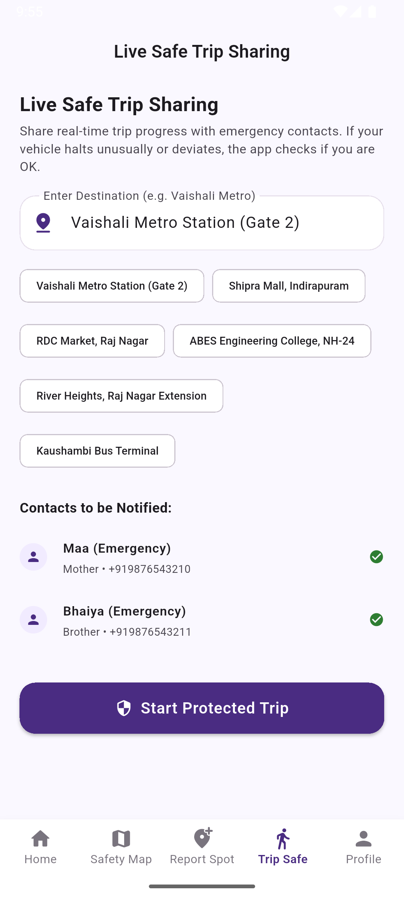
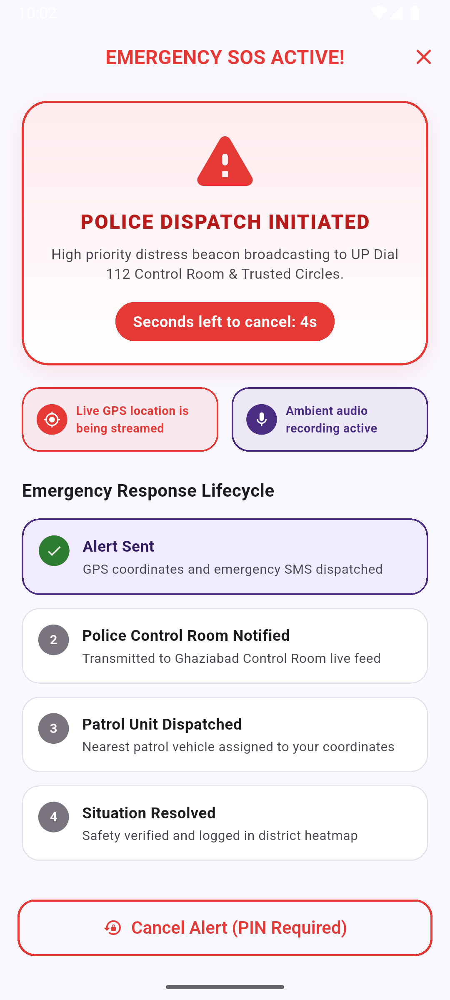
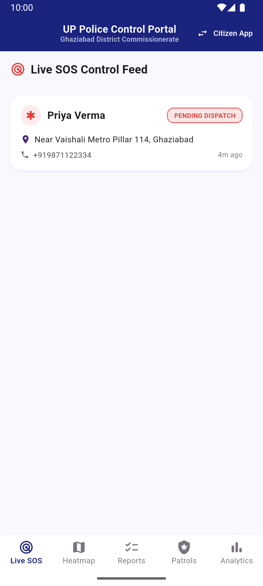
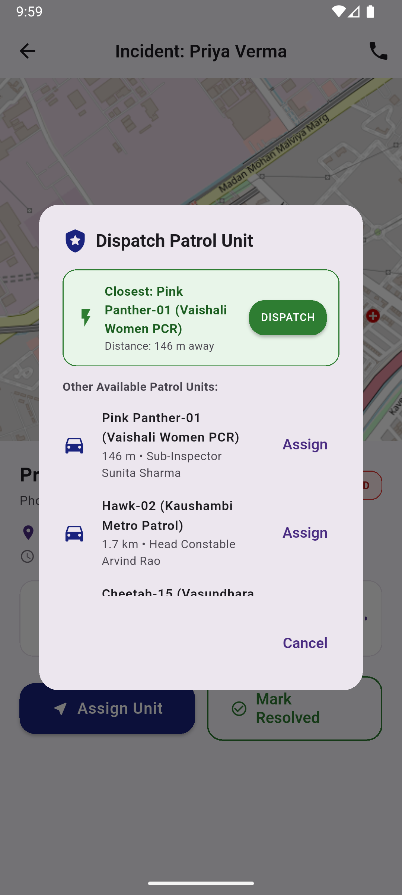
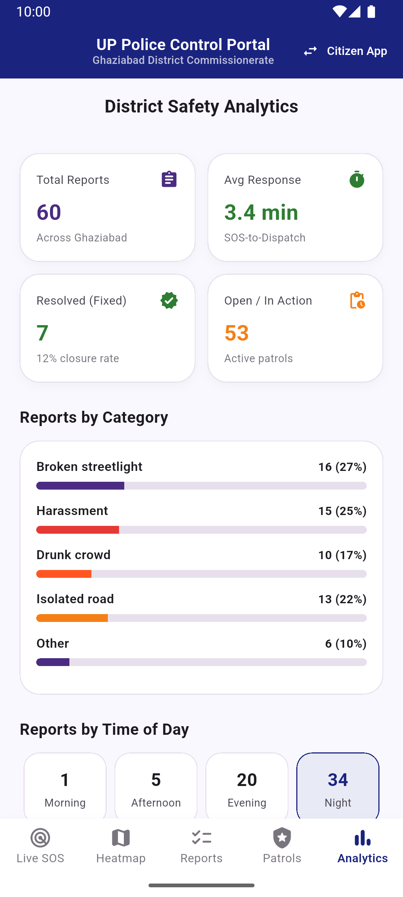

# 🛡️ Suraksha Ghaziabad (सुरक्षा ग़ाज़ियाबाद)
> *"Aapki Suraksha, Hamari Zimmedari"*  
> **Ghaziabad Seva First Innovation Challenge 2026** • Problem Statement: **Safe City for Women**

---

## 📱 Executive Overview
**Suraksha Ghaziabad** is a production-style, mobile-first women's safety ecosystem developed for district-level safety in Ghaziabad, Uttar Pradesh. It bridges citizens in distress directly with the district administration and police control room through a single unified mobile application.

- **One-Tap Emergency Distress Beacon**: High-visibility 160dp pulsing SOS with a 5-second false-alarm cancel window protected by an emergency PIN.
- **District Safety Heatmap**: Dynamic OpenStreetMap canvas visualization powered by citizen reports of broken streetlights, isolated stretches, and harassment hotspots across 60+ Ghaziabad localities.
- **Dual Role In-App Architecture**: Both Citizen and Police/Control Room Officer roles operate seamlessly within the same app without requiring separate PC dashboards or web consoles.
- **Zero-Setup Mock & Live Firebase Switching**: Runs out-of-the-box with in-memory persistence and rich seed data, with a single-flag toggle (`AppConfig.useFirebase = true`) to enable live Cloud Firestore, Auth, and Messaging.

---

## 📸 Application Screenshots

| Citizen Home & SOS | Ghaziabad Safety Heatmap | Report Unsafe Location |
| :---: | :---: | :---: |
|  |  |  |

| Safe Trip Sharing | Live SOS Active Beacon | Police Live SOS Feed |
| :---: | :---: | :---: |
|  |  |  |

| Nearest Patrol Dispatch | District Safety Analytics |
| :---: | :---: |
|  |  |

---

## 🚀 Key Features

### 1. Citizen Safety Hub
- **Pulsing SOS Trigger**: Hold for 2 seconds or tap with confirmation to dispatch emergency beacon.
- **Physical Shake Trigger**: Shake phone 3 times vigorously to trigger SOS automatically (`sensors_plus`).
- **Emergency Cancellation PIN**: Cancelling false alerts requires a cryptographic SHA-256 hashed 4-digit PIN.
- **SMS Fallback Dispatch**: If offline or internet drops, automatically composes and triggers SMS with precise GPS Google Maps links (`https://maps.google.com/?q=lat,lng`) to registered trusted emergency circles.
- **Live Safe Trip Sharing**: Start trip with destination, continuous route polyline tracking, and periodic "Are you OK?" auto-checks with a 60-second emergency alert countdown.
- **Nearby Emergency Help Directory**: Geocoded directory of Ghaziabad Mahila Thana, Pink Booths, PCR stations, and emergency hospitals with one-tap calling and directions.
- **Discreet Fake Call Simulator**: Schedule realistic incoming phone calls with authentic Android ringing UI, haptic vibrations, and simulated audio dialog to safely excuse oneself from uncomfortable situations.

### 2. Police & Administrative Officer Mode
- **Officer Portal Entry**: Discreet link on the login screen (`OFFICER01` / PIN `1234`).
- **Live SOS Control Feed**: Real-time incoming distress feed with timestamp, moving GPS coordinates, and status lifecycle chips (`NEW ALERT`, `DISPATCHED`, `RESOLVED`).
- **SOS Detail & Moving Trail**: Live breadcrumb polyline tracking of distress movement, emergency contact list, ambient audio evidence player, and direct call button.
- **Automated Nearest Patrol Dispatch**: Automated Haversine distance calculation to dispatch the closest available PCR Cheetah/Pink Panther unit.
- **Civic Hazard Moderation**: Review citizen reports and update status (`Open` ➔ `In progress` ➔ `Fixed`) with MCD / Police action notes.
- **District Crime & Safety Analytics**:
  - Total incident tracking and 3.4 min average SOS-to-dispatch response time.
  - Top 10 high-risk zones across Ghaziabad.
  - Category breakdown bars (Harassment, Isolated Road, Drunk Crowd, Broken Streetlight).
  - Time-of-day hazard distribution (Night vs Evening vs Afternoon).

### 3. Demo Mode (For Innovation Pitch & Evaluation)
- Built-in persistent toggle in Settings.
- Pre-seeded with **60 realistic hazard reports** across Ghaziabad (Indirapuram, Vaishali, Raj Nagar Extension, Crossings Republik, Kaushambi, Sahibabad, Vasundhara, Govindpuram, Kavi Nagar).
- Interactive **"Simulate Police Response"** control on the SOS Active screen, allowing testers to demonstrate the end-to-end lifecycle on a single device without needing a second phone.

---

## 🔑 Demo Credentials (Mock Mode)

| Role | Access Route | Identifier / Phone | PIN / OTP |
| :--- | :--- | :--- | :--- |
| **Citizen (Default)** | Login Screen | Any 10-digit number (e.g. `9876543210`) | `123456` |
| **Emergency Cancel PIN** | Default Profile Setup | Pre-set on demo profile | `1234` |
| **Police Officer** | Officer Login Link | `OFFICER01` | `1234` |

---

## 🛠️ Tech Stack & Architecture

- **Framework**: Flutter 3.47+ (Dart 3.13+)
- **Architecture**: Repository Pattern with Abstract Interfaces + In-Memory Mock Implementations + Firebase Production Stubs
- **State Management**: Riverpod (`flutter_riverpod`)
- **Navigation**: `go_router`
- **Maps**: `flutter_map` with OpenStreetMap Raster Tiles & Custom Canvas Heatmap (`latlong2`)
- **Sensors & Hardware**: `sensors_plus`, `geolocator`, `crypto`, `shared_preferences`, `url_launcher`
- **Localization**: Full Bilingual Support (Hindi + English) via `AppLocalizations`
- **Target Platform**: Android first (Mobile Portrait 360x800 dp only)

---

## 📁 Project Structure

```
lib/
├── app.dart                          # Root MaterialApp.router with themes & localization
├── main.dart                         # Portrait orientation lock & ProviderScope initialization
├── core/
│   ├── config/app_config.dart        # Single-flag Firebase switch (useFirebase)
│   ├── constants/app_constants.dart  # Geocenter coordinates, demo credentials, hotline numbers
│   ├── l10n/app_localizations.dart   # Complete English & Hindi dictionary
│   ├── theme/                        # Material 3 colors, typography, light & dark themes
│   └── utils/                        # SHA-256 HashUtil, DistanceUtil (Haversine), DateFormatter
├── data/
│   ├── models/                       # UserModel, SosAlertModel, ReportModel, PatrolUnit, Trip
│   ├── providers/                    # Riverpod StateNotifiers for auth, sos, reports, trips, settings
│   └── repositories/
│       ├── abstract/                 # Abstract repository interfaces
│       ├── mock/                     # Zero-setup in-memory mock repositories with broadcast streams
│       └── firebase/                 # Firebase repository implementations
└── features/
    ├── auth/                         # Citizen login, OTP verify, officer login, profile setup
    ├── fake_call/                    # Realistic scheduled incoming call & ongoing call dialog
    ├── home_sos/                     # Pulsing 160dp SOS button, active emergency countdown
    ├── map/                          # OpenStreetMap, dynamic canvas heatmap, spot details
    ├── nearby_help/                  # Police stations, pink booths, hospitals directory
    ├── officer/                      # Live SOS feed, breadcrumb detail, patrol dispatch, analytics
    ├── onboarding/                   # Animated splash, language select, plain-language consent
    ├── profile/                      # Settings, emergency PIN updater, trusted contacts, delete data
    ├── reports/                      # Pinpoint unsafe spot reporting & My Reports tracker
    └── trips/                        # Live trip safe sharing with 60-second auto-check dialog
```

---

## ⚡ Setup & Run Instructions

### Prerequisites
1. Ensure Flutter 3.24+ or 3.47+ is installed and available in your environment:
   ```bash
   flutter --version
   ```
2. Connected Android physical phone (via USB debugging) or Android Virtual Device (AVD).

### Running in Mock Mode (Default - Zero Setup Required)
```bash
# 1. Fetch dependencies
flutter pub get

# 2. Run static analyzer (0 errors guaranteed)
flutter analyze

# 3. Run automated tests
flutter test

# 4. Launch on Android device / emulator
flutter run
```

---

## 🔥 Switching to Live Firebase Backend

1. In `lib/core/config/app_config.dart`, update the single configuration flag:
   ```dart
   static const bool useFirebase = true;
   ```
2. Add your Firebase `google-services.json` inside `android/app/`.
3. Add Firebase packages to `pubspec.yaml`:
   ```yaml
   firebase_core: ^3.6.0
   firebase_auth: ^5.3.1
   cloud_firestore: ^5.4.4
   ```
4. Deploy the production security rules defined in `firestore.rules`:
   ```bash
   firebase deploy --only firestore:rules
   ```

---

## 📦 Building Debug APK

To generate a standalone installable Android APK:

```bash
flutter build apk --debug
```

The compiled APK will be output to:
`build/app/outputs/flutter-apk/app-debug.apk`

To install directly to a connected Android phone:
```bash
flutter install
```

---

## 🛡️ Privacy & Compliance Notice
Suraksha Ghaziabad was designed specifically for the **Ghaziabad Seva First Innovation Challenge 2026**. Location data is accessed solely during active SOS alerts or user-initiated trips. Civic hazard reports are anonymous by default. Emergency PINs are stored exclusively as SHA-256 hashes. Designed to integrate with UP Dial 112 & District Police Control Room.
